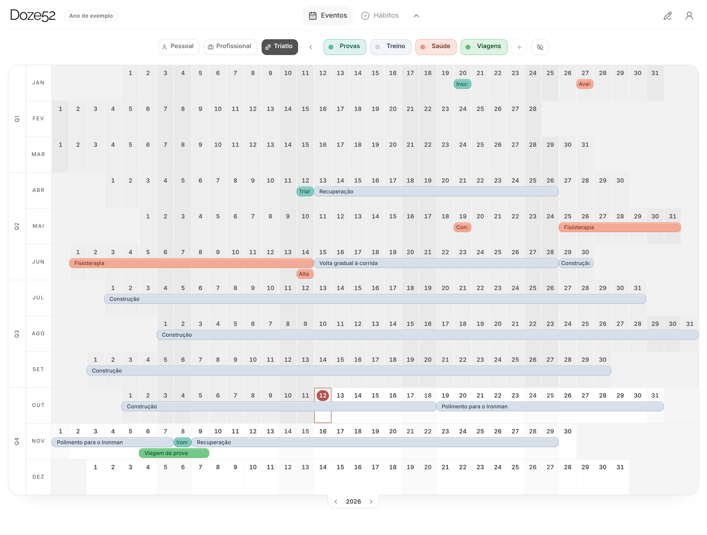
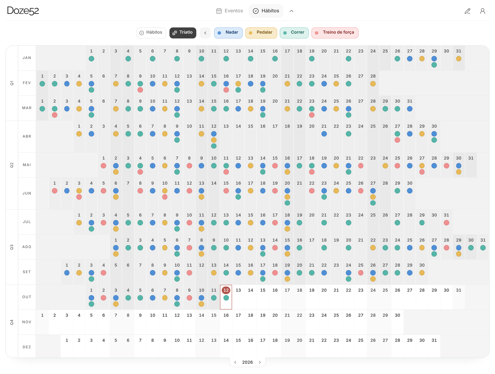
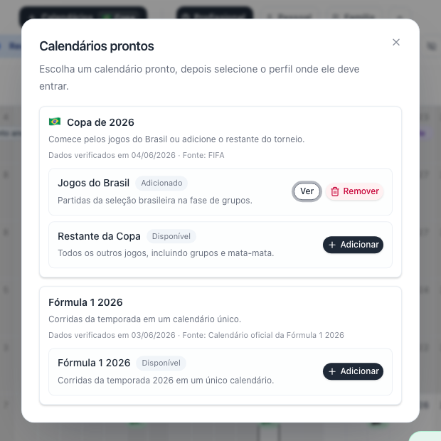

  <picture>
    <source media="(prefers-color-scheme: dark)" srcset="assets/doze52-logo-dark.svg" />
    
  </picture>

<strong>See your whole year. Plan with focus. Keep the habits that get you there.</strong>

  <a href="https://doze52.com.br">doze52.com.br</a> ·
  <a href="https://instagram.com/doze.52">Instagram</a> ·
  <a href="https://x.com/doze_52">X</a>

---

Doze52 is a visual year planner I design and build solo. It is for people who think in months, not only in to-do lists: the whole year sits in one grid, and events and habits share that same timeline.

> **About this repository.** The product source code is private. This repo is the public window into the work: what Doze52 does, how it is built, and what has shipped. Day-to-day commits show up on my contribution graph.

  

## What it does

- **The year in one screen.** Twelve months in a single grid, with multi-day events, drag-and-drop editing and recurrence (weekly, biweekly, monthly, yearly).
- **Contexts.** Work, personal, family, or a training plan stay separate, each with its own categories, without heavy setup.
- **Habits on the same timeline.** Mark habits day by day and watch streaks form across the year, next to the events that explain them.
- **Ready-made calendars.** Add holidays, football leagues, the World Cup or Formula 1 in one click. The catalog refreshes itself from official sources.
- **Installable and offline-safe.** It works as a PWA on desktop and mobile. Edits made offline are kept and synced when the connection returns.
- **Your data stays yours.** Google sign-in, cloud sync across devices, and export to JSON and CSV.

  

  

## Product decisions

- **Year-first.** The year is the main view, not a mode hidden behind a menu.
- **Contexts before complexity.** Life areas stay apart without asking for configuration up front.
- **Local safety, then cloud.** Progress is protected on the device first and reconciled with the account later, so a bad connection never costs an edit.
- **The onboarding tells a story.** New users explore a sample year (someone training for an Ironman) where events and habits explain each other, instead of an empty grid.
- **Polish is product work.** Legibility, drag behavior, density and modal flow get the same attention as features.

## How it is built

| Layer | Choices |
| --- | --- |
| App | Next.js 16, React 19, TypeScript, Tailwind CSS 4, Zustand |
| Data and auth | Supabase (Postgres with row-level security, Google OAuth) |
| Billing | Stripe subscriptions (Free and Pro) |
| Delivery | Vercel with separate dev and production environments, installable PWA with a service worker |
| Quality | Playwright end-to-end suites for calendar, habits, onboarding, offline and account continuity |

A few numbers from the private repo: 60k+ lines of TypeScript and SQL, 140+ pull requests, 35 versioned database migrations, and eight Playwright test suites.

## Shipping log

| When | What shipped |
| --- | --- |
| Oct 2026 | Installable PWA with offline mode, mobile onboarding, account continuity across devices |
| Sep 2026 | Unlimited habits and habit contexts on Pro, the Ironman sample year, category archiving |
| Aug 2026 | Habits as a second surface, new navigation, self-refreshing catalog with every Brasileirão club, spreadsheet import |
| Jul 2026 | Ready-made calendars in production, guided onboarding with a sample year |
| Jun 2026 | Brand refresh, mobile layout, Free and Pro plans with Stripe |
| Feb to May 2026 | First version: year grid, contexts, categories, recurrence, sync and export |

## About me

I am Conrado Vidal. I work with strategy, delivery and product development. Doze52 is where I take a product from a real problem to shipped increments on my own: discovery, prioritization, design, code and release. More on my [GitHub profile](https://github.com/conradovidal) and [LinkedIn](https://www.linkedin.com/in/conradovidal/).

Feedback is welcome at [doze52cal@gmail.com](mailto:doze52cal@gmail.com).

---

© 2026 Conrado Vidal. All rights reserved. The text and images in this repository may not be reused without permission.
